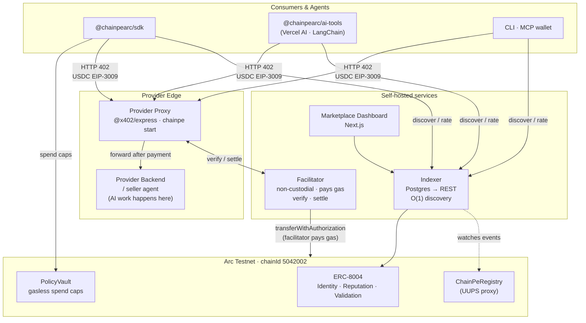
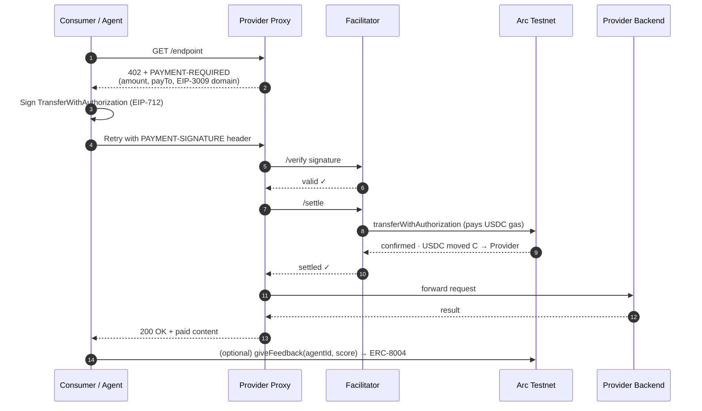

<div align="center">

# ChainPe

### Payment + reputation rails for the autonomous agent economy

**Live on Circle's Arc Testnet**, where USDC is the gas token. ChainPeRegistry and PolicyVault are deployed and verified (see [Deployments](docs/DEPLOYMENTS.md)); every package defaults to them. The facilitator is self-hosted.

### Live link: **[chainpe.vercel.app](https://chainpe.vercel.app/)**

[](https://opensource.org/licenses/MIT)
[](https://explorer.testnet.arc.io)
[](https://x402.org)
[](https://eips.ethereum.org/EIPS/eip-8004)

**[Marketplace](https://chainpe.vercel.app/)**

</div>

---

## The Problem

AI agents are starting to do real work — calling APIs, hiring other agents, buying data — but the money layer hasn't caught up:

- **Agents can't pay autonomously.** Every paid API still expects an API key, a signup, and a prepaid balance set up by a human in advance.
- **Providers can't monetize per-call.** Charging for a single request means building billing, metering, and a payments backend.
- **No one knows who to trust.** There is no portable, verifiable way for one agent to judge whether another agent or service is any good.

## The Solution

**ChainPe is payment + reputation infrastructure for the machine economy.** It lets software transact with software — no humans in the loop.

| | |
|---|---|
| 💸 **Monetize any HTTP API in one command** | Per-call pricing in USDC, zero backend changes. |
| 🤖 **Agents pay in 3 lines of code** | Discover, pay for, and rate services autonomously. |
| ⚡ **Agents only hold USDC** | On Arc, [USDC is the gas token](https://docs.arc.io/arc/concepts/stable-fee-design). For x402 calls a non-custodial, self-hosted facilitator submits the payment and pays the gas. |
| ⭐ **Reputation on every paid call** | Tamper-proof [ERC-8004](https://eips.ethereum.org/EIPS/eip-8004) ratings that agents use to route work. |
| 🔒 **On-chain spending caps** | **PolicyVault** enforces budgets on-chain — the chain rejects overspends, not a backend. |

ChainPe is infrastructure, not an app. One core powers an SDK, Vercel AI SDK / LangChain tools, a CLI, a Claude MCP wallet, a marketplace dashboard, an indexer, and a self-hosted facilitator.

---

## Pay-per-Request in 3 Lines

```ts
import { ChainPe } from '@chainpearc/sdk'

const cp = new ChainPe({ privateKey: process.env.PRIVATE_KEY })      // Arc Testnet, live contracts by default
const res = await cp.fetch('https://api.example.com/paid-endpoint')  // auto-handles 402
const data = await res.json()
```

`cp.fetch` is a drop-in replacement for `fetch`. On `402 Payment Required` (x402 v2, `PAYMENT-REQUIRED` header) it signs a USDC [EIP-3009](https://eips.ethereum.org/EIPS/eip-3009) authorization and retries with `PAYMENT-SIGNATURE`; the provider's proxy has its facilitator settle it — returning the real `200`. The payer signs; the facilitator submits the transaction and covers gas.

> **Full SDK surface:** `cp.fetch` · `cp.pay` · `cp.discover` · `cp.getReputation` · `cp.giveFeedback` · `cp.balance`

---

## Architecture



### Payment Flow



**The consumer only needs USDC. The facilitator holds no funds. The provider never touches keys.**

---

## Network — Arc Testnet

| | |
|---|---|
| Network id | `arc-testnet` (the only supported network) |
| Chain id | `5042002` (`0x4cef52`) |
| x402 network id | `eip155:5042002` (x402 v2) |
| RPC | `https://rpc.testnet.arc.io` (override: `ARC_RPC_URL`) |
| Explorer | [explorer.testnet.arc.io](https://explorer.testnet.arc.io) |
| Gas | USDC (native, 18 decimals at the balance level) |
| USDC (ERC-20) | `0x3600000000000000000000000000000000000000` (6 decimals; same funds as the native balance) |
| Faucet | [faucet.circle.com](https://faucet.circle.com) → Arc Testnet |
| Facilitator | Self-hosted: [`services/chainpe-facilitator`](services/chainpe-facilitator), `CHAINPE_FACILITATOR_URL` |

### Contracts (live)

| Contract | Address |
|---|---|
| ChainPeRegistry (UUPS proxy, 1 USDC registration fee) | [`0x79c7a22993A40A3c88355b737e6F608c6610c395`](https://explorer.testnet.arc.io/address/0x79c7a22993A40A3c88355b737e6F608c6610c395) |
| PolicyVault (UUPS proxy) | [`0xcD5f994A57d7846c3DdFb471cBf4EdA0Bcf43a81`](https://explorer.testnet.arc.io/address/0xcD5f994A57d7846c3DdFb471cBf4EdA0Bcf43a81) |
| ChainPeTimelock (48h) | [`0x5071794F30C32604Be115c00Ed041c403fB2f302`](https://explorer.testnet.arc.io/address/0x5071794F30C32604Be115c00Ed041c403fB2f302) |
| ERC-8004 IdentityRegistry (Arc canonical) | [`0x8004A818BFB912233c491871b3d84c89A494BD9e`](https://explorer.testnet.arc.io/address/0x8004A818BFB912233c491871b3d84c89A494BD9e) |
| ERC-8004 ReputationRegistry (Arc canonical) | [`0x8004B663056A597Dffe9eCcC1965A193B7388713`](https://explorer.testnet.arc.io/address/0x8004B663056A597Dffe9eCcC1965A193B7388713) |
| ERC-8004 ValidationRegistry (Arc canonical) | [`0x8004Cb1BF31DAf7788923b405b754f57acEB4272`](https://explorer.testnet.arc.io/address/0x8004Cb1BF31DAf7788923b405b754f57acEB4272) |

These are baked into `@chainpearc/sdk` (`ARC_TESTNET_CONTRACTS`, `ARC_TESTNET_ERC8004`), so no
address configuration is needed. `CHAINPE_REGISTRY_ADDRESS`, `POLICY_VAULT_ADDRESS`,
`ERC8004_IDENTITY_REGISTRY` and `ERC8004_REPUTATION_REGISTRY` override them. Implementations,
deploy blocks and end-to-end settlement transactions are in [`docs/DEPLOYMENTS.md`](docs/DEPLOYMENTS.md).

---

## 📦 Packages

The packages use the `@chainpearc` scope. **They are not on npm yet**; build them from this repo (see [Local Development](#local-development)) and install by path, e.g. `npm install ./packages/chainpe-sdk`.

| Package | Path | Description |
|---------|------|-------------|
| `@chainpearc/sdk` | `packages/chainpe-sdk` | Core SDK for payments, discovery, reputation and PolicyVault. |
| `@chainpearc/ai-tools` | `packages/chainpe-ai-tools` | Vercel AI SDK and LangChain tools. |
| `@chainpearc/cli` | `packages/chainpe` | `chainpe` CLI: provider proxy, register, fetch, discover. |
| `@chainpearc/agent` | `packages/chainpe-agent` | Standalone autonomous LLM agent loop. |
| `chainpe-wallet-mcp` | `packages/chainpe-wallet` | Claude MCP wallet (built as an `.mcpb` bundle). |

---

## Quick Start

### For Providers — Monetize Any API

```bash
npm install -g ./packages/chainpe            # @chainpearc/cli, after building (see Local Development)
export CHAINPE_FACILITATOR_URL=http://localhost:4500   # your self-hosted facilitator
chainpe init      # guided setup → ~/.chainpe/config.json (saves the facilitator URL)
chainpe start     # x402 payment proxy in front of your API (no backend changes)
chainpe register  # publish on ChainPeRegistry (1 USDC fee), MetaMask or pasted key
```

The proxy intercepts every request, gates on payment, and forwards to your backend only after the facilitator confirms settlement. Your backend never touches keys, USDC, or x402 headers.

To embed the proxy in your own Node process (env-configured example: [`examples/proxy-railway`](examples/proxy-railway)):

```ts
import { startProxyServer } from '@chainpearc/cli'

await startProxyServer({
  config: {
    serviceName: 'Weather API', serviceDescription: '', tags: [],
    targetUrl: 'http://localhost:3001',        // your backend
    pricePerRequest: '0.01', paymentToken: 'USDC',
    walletAddress: process.env.WALLET_ADDRESS!, // receives USDC
    proxyPort: 4402, network: 'arc-testnet',
    facilitatorUrl: process.env.CHAINPE_FACILITATOR_URL // self-hosted services/chainpe-facilitator
  }
})
```

### Self-host the facilitator

```bash
cd services/chainpe-facilitator
cp .env.example .env     # FACILITATOR_PRIVATE_KEY = a dedicated gas key funded with USDC
npm install && npm run build && npm start      # :4500
curl http://localhost:4500/health
```

Full guide: [`services/chainpe-facilitator/DEPLOY.md`](services/chainpe-facilitator/DEPLOY.md) and the docs page *Self-hosting the facilitator*.

### For Consumers / Agents

<details open>
<summary><b>SDK</b></summary>

```ts
import { ChainPe } from '@chainpearc/sdk'

const cp = new ChainPe({ privateKey: process.env.KEY })

// Pay and receive in one call
const res = await cp.fetch('https://api.example.com/endpoint')

// Discover reputation-ranked services
const services = await cp.discover({ tags: ['weather', 'ai'] })

// Check the USDC balance (USDC is also the gas token on Arc)
const { usdc } = await cp.balance()

// Rate a service after a paid call
await cp.giveFeedback(agentId, 90)  // score out of 100
```
</details>

<details>
<summary><b>Vercel AI SDK</b></summary>

```ts
import { createChainPeTools } from '@chainpearc/ai-tools/vercel'

const tools = createChainPeTools({ privateKey })  // { chainpeFetch, discoverService } for generateText / streamText
```
</details>

<details>
<summary><b>LangChain</b></summary>

```ts
import { createChainPeLangChainTools } from '@chainpearc/ai-tools/langchain'

const { chainpeFetchTool, discoverServiceTool } = createChainPeLangChainTools({ privateKey })
```
</details>

<details>
<summary><b>Claude MCP</b></summary>

```bash
npm run build:mcpb --workspace=chainpe-wallet-mcp
# double-click chainpe.mcpb → installs into Claude Desktop
```

Claude gets 8 tools: `search_bazaar`, `x402_fetch`, `pay`, `transfer_usdc`, `give_feedback`, `spending_report`, `check_balance`, `request_funding`.
</details>

---

## Testing

```
contracts/
  Hardhat test suites:
  ├── ChainPeRegistry.test.ts             — register, deregister, fee, access control (through the UUPS proxy)
  ├── ChainPeRegistryUpgradeable.test.ts  — proxy initialisation, upgrades, pause
  ├── PolicyVault.test.ts                 — deposit, setPolicy, gasless spend, overspend rejection (through the UUPS proxy)
  ├── PolicyVaultUpgradeable.test.ts      — proxy initialisation, upgrades, pause
  └── ERC8004.test.ts                     — identity mint, reputation feedback, self-feedback block
```

```bash
cd contracts && npm install && npx hardhat test     # 79 tests
npm test                                            # package unit tests (from the repo root)
```

### End-to-end on live Arc Testnet

Both scripts run against the deployed contracts and a local facilitator, and clean up after themselves:

```bash
# terminal 1: self-hosted facilitator (gas key funded with a little USDC)
cd services/chainpe-facilitator && npm install && FACILITATOR_PRIVATE_KEY=0x... npm run dev

# terminal 2: a wallet with ~3.5 USDC from https://faucet.circle.com (Arc Testnet)
CHAINPE_PRIVATE_KEY=0x... npm run test:e2e        # 7 flows: health, registry, x402 payment, discovery, reputation, register, PolicyVault
CHAINPE_PRIVATE_KEY=0x... npm run test:e2e:a2a    # buyer agent hires two seller agents and rates them
```

The transactions from the launch run are listed in [`docs/DEPLOYMENTS.md`](docs/DEPLOYMENTS.md#settlements-recorded-on-arc-testnet).

---

## Local Development

```bash
git clone https://github.com/anindhabiswas25/chainpe-arc.git ChainPe
cd ChainPe

# Install and build all packages (the SDK first; the others depend on it)
npm install
npm run build:sdk && npm run build
# If the build fails with "Cannot find module @rollup/rollup-linux-x64-gnu" (npm
# optional-dependency bug), run:
#   npm i --no-save @rollup/rollup-linux-x64-gnu@$(node -p "require('rollup/package.json').version")

# Run all package tests
npm test

# Run contract tests
cd contracts && npx hardhat test

# Start the dashboard (http://localhost:3000) and landing + docs (http://localhost:3002)
npm run dev:dashboard
npm run dev:landing
```

### Environment Variables

```bash
# Required for on-chain interactions
DEPLOYER_PRIVATE_KEY=0x...          # wallet with USDC on Arc Testnet (USDC also pays gas)
ARC_RPC_URL=https://rpc.testnet.arc.io

# Contract addresses default to the live Arc Testnet deployment; override only if needed
# CHAINPE_REGISTRY_ADDRESS=0x79c7a22993A40A3c88355b737e6F608c6610c395
# POLICY_VAULT_ADDRESS=0xcD5f994A57d7846c3DdFb471cBf4EdA0Bcf43a81
# ERC8004_IDENTITY_REGISTRY=0x8004A818BFB912233c491871b3d84c89A494BD9e
# ERC8004_REPUTATION_REGISTRY=0x8004B663056A597Dffe9eCcC1965A193B7388713

# Self-hosted facilitator (services/chainpe-facilitator)
CHAINPE_FACILITATOR_URL=http://localhost:4500
```

---

## Deploy Your Own Stack

The contracts are already live, so most operators only need steps 2 to 4.

```bash
# 1. (Optional) deploy your own contracts to Arc Testnet; see docs/DEPLOYMENTS.md for the full runbook
cd contracts
DEPLOYER_PRIVATE_KEY=0x... OWNER_ADDRESS=0xYourSafe npm run deploy:arc-testnet

# 2. Run your facilitator (Docker, Node, or Railway — see services/chainpe-facilitator/DEPLOY.md)
#    Env: FACILITATOR_PRIVATE_KEY=<dedicated gas key funded with USDC>. Build from the repo root:
docker build -f services/chainpe-facilitator/Dockerfile -t chainpe-facilitator .
docker run -e FACILITATOR_PRIVATE_KEY=0x... -p 4500:4500 chainpe-facilitator

# 3. Run the indexer (Postgres required)
#    Env: DATABASE_URL. Registry, reputation registry and START_BLOCK default to the live deployment.
docker build -f services/chainpe-indexer/Dockerfile -t chainpe-indexer .

# 4. Build the dashboard (Vercel or any Node host)
#    Env: INDEXER_URL, CHAINPE_FACILITATOR_URL, NEXT_PUBLIC_CHAINPE_REGISTRY_ADDRESS, ...
npm run build --prefix apps/dashboard
```

---

## Documentation

| Doc | What it covers |
|---|---|
| [`docs/DEPLOYMENTS.md`](docs/DEPLOYMENTS.md) | Live addresses, verification status, recorded settlements, deploy runbook |
| [`ARC_INTEGRATION.md`](ARC_INTEGRATION.md) | Arc Testnet reference: constants, x402 v2 wire format, facilitator, public API |
| [`docs/STRUCTURE.md`](docs/STRUCTURE.md) | Full project structure reference |
| [`docs/CHANGELOG.md`](docs/CHANGELOG.md) | Version history |
| [`contracts/SECURITY.md`](contracts/SECURITY.md) | Security notes + Slither triage + post-deploy checklist |

---

## License

[MIT](LICENSE)
