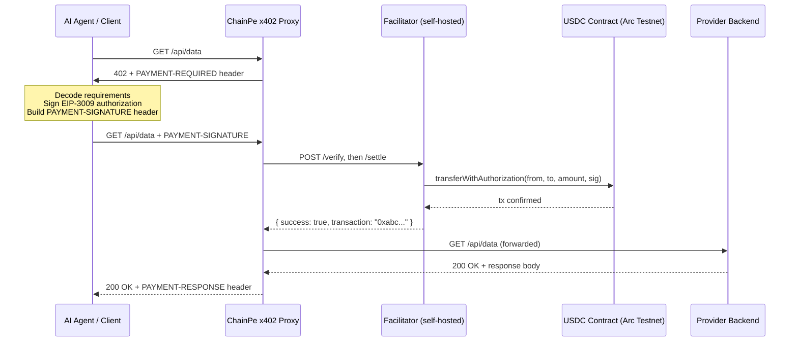

# x402 Protocol

x402 is an extension of HTTP that uses the long-reserved `402 Payment Required` status code to implement machine-native API payments. ChainPe implements x402 with USDC on Arc Testnet.

## History of HTTP 402

HTTP status code `402 Payment Required` was defined in RFC 2616 (HTTP/1.1, 1999) with the note "reserved for future use." The intent was always to enable per-request payments, but no standard was ever ratified — because the payment infrastructure did not exist. Blockchains and stablecoins changed that.

The x402 specification formalizes how `402` should be used: what the challenge must contain, what header the client attaches on retry, and how a facilitator settles the payment on-chain. ChainPe uses **x402 v2** (`@x402/core`, `@x402/evm`, `@x402/express`, `@x402/fetch`), which includes Arc Testnet as a built-in network.

## x402 request flow



## Payment requirements (`PAYMENT-REQUIRED`)

An x402 endpoint answers an unpaid request with `402` and a `PAYMENT-REQUIRED` header. The header is base64-encoded JSON:

```json
{
  "x402Version": 2,
  "resource": { "url": "https://api.example.com/api/data", "description": "Weather data per query" },
  "accepts": [
    {
      "scheme": "exact",
      "network": "eip155:5042002",
      "asset": "0x3600000000000000000000000000000000000000",
      "amount": "10000",
      "payTo": "0xProviderWalletAddress",
      "maxTimeoutSeconds": 300,
      "extra": { "name": "USDC", "version": "2", "agentId": "42" }
    }
  ]
}
```

Key fields:
- `x402Version`: `2`
- `scheme`: `"exact"`, meaning the exact stated amount is transferred (no partial payments)
- `network`: the CAIP-2 id, `eip155:5042002` for Arc Testnet. ChainPe's own network name is `arc-testnet`; the SDK and CLI translate between the two.
- `asset`: the USDC ERC-20 interface on Arc Testnet
- `amount`: the price in atomic units (USDC has 6 decimals, so `10000` = 0.01 USDC)
- `payTo`: the wallet that receives the payment
- `extra.name` / `extra.version`: USDC's EIP-712 domain on Arc (`USDC` / `2`)
- `extra.agentId`: a ChainPe extension carrying the provider's ERC-8004 agent id (see below)

## Payment header (`PAYMENT-SIGNATURE`)

The client picks the matching offer, signs a USDC EIP-3009 `transferWithAuthorization` for exactly `amount` to `payTo`, and retries with the signed payload base64-encoded in `PAYMENT-SIGNATURE`. Decoded, the payload carries the accepted offer plus:

```json
{
  "signature": "0x...",
  "authorization": {
    "from": "0xAgentWallet",
    "to": "0xProviderWallet",
    "value": "10000",
    "validAfter": "1718000000",
    "validBefore": "1718000300",
    "nonce": "0x...random bytes32..."
  }
}
```

## Settlement receipt (`PAYMENT-RESPONSE`)

After the facilitator settles, the proxy forwards the request to the backend and adds a `PAYMENT-RESPONSE` header (base64 JSON):

```json
{ "success": true, "transaction": "0xabc123...", "network": "eip155:5042002", "payer": "0xAgentWallet" }
```

`cp.pay()` decodes it and returns the hash as `result.payment.txHash`.

## ChainPe extensions to x402

### Provider agentId advertisement

The proxy sets the provider's ERC-8004 `agentId` in each offer's `extra.agentId` and in the `X-CHAINPE-AGENT-ID` response header. That lets the SDK post reputation feedback after a successful payment without scanning the registry.

### Network matching

The SDK uses only offers for `eip155:5042002` with Arc USDC. If a server offers only other networks, it throws `server accepts [...] but wallet is on arc-testnet`.

## How ChainPe implements x402

### Provider side: `@chainpearc/cli`

`chainpe start` (and `startProxyServer()`) runs an Express proxy with `@x402/express`'s `paymentMiddleware`, wired to your facilitator through `HTTPFacilitatorClient` (`facilitatorUrl` or `CHAINPE_FACILITATOR_URL`). It answers unpaid requests with `402`, and on a paid retry calls the facilitator's `/verify` and `/settle` before forwarding.

### Consumer side: `@chainpearc/sdk`

`ChainPe.fetch()` runs the flow: request → decode `PAYMENT-REQUIRED` → check `maxPerCall` → sign → retry with `PAYMENT-SIGNATURE` → decode `PAYMENT-RESPONSE`. Any stock x402 v2 client (for example `@x402/fetch` with `ExactEvmScheme`) can pay ChainPe endpoints too.

## Supported networks

| x402 network (CAIP-2) | ChainPe network | USDC | Notes |
|---|---|---|---|
| `eip155:5042002` | `arc-testnet` | `0x3600000000000000000000000000000000000000` | **The only supported network: Arc Testnet** |

The self-hosted facilitator advertises it in `GET /supported` and accepts only Arc USDC on this network.
